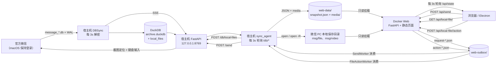

# WeMsg Web MVP 设计

## 目标

在现有“微信实时收发 + DuckDB 归档”能力之上，做一个仿微信 UI 的 Web 页面：

- 左侧：群聊、联系人会话列表
- 右侧：当前会话的实际消息窗口
- 每 3 秒刷新一次；消息元数据从 DuckDB 快照读取，文件/视频/图片附件从微信 PC 本地保存目录直接读取
- 软件启动后，所有微信群聊/朋友的新收、新发消息都能在页面看到
- Web 服务用 Docker 部署；Electron 线上版加载部署后的 Web URL

## 架构



### 为什么加 sync_agent

Docker 容器是 Linux 环境，不能运行 macOS 的截图/键盘/取钥代码；同时 DuckDB 正在被宿主机 DBSync 每 3 秒写入，跨进程直接读同一文件容易抢锁。因此：

1. 宿主机 `sync_agent.py` 通过已有 `/db/*` API 读取 DuckDB 查询结果（宿主机进程内已做并发锁）。
2. 宿主机把结果写成原子替换的 `web-data/snapshot.json`，并把媒体文件复制/增量同步到 `web-data/media/`。
3. Docker 只读挂载 `web-data`，不接触微信数据库、密钥或 macOS 权限。

## 数据流与消息类型

| 类型 | DuckDB 字段 | Web 展示 |
| --- | --- | --- |
| 文本 | `type=1`, `content` | 气泡；`[表情名]` 按 `WX_EMOJI` 映射为 Unicode，未知 token 原样保留 |
| 引用回复 | `type=244813135921`, `detail_json.text/refer` | 气泡内灰色引用块（`refer.sender：refer.summary`）+ 分隔线 + `detail.text` 正文；点击引用块滚动到原消息并高亮 |
| 图片 | `type=3`, `detail_json.md5` | `media` 表按 md5 匹配，内联 ``，点击放大 |
| 视频 | `type=43`, `detail_json.duration_sec/size` | 视频卡片（缩略图/时长/大小/播放图标）；通过 `message_resource.db` 的缩略图 md5 关联；完整文件按 `videomsg.length` 字节数匹配 `msg/video/**`，`/api/local-file/<token>` 直接播放 |
| 语音 | `type=34` | 语音气泡；有 transcript 时显示文字，否则显示“无音频/无转写” |
| 系统 | `type=10000` | 居中的灰色系统提示 |
| 文件 | `(type & 0xFFFFFFFF)=49`, `subtype=6` | 文件卡片（扩展名图标/文件名/大小/操作）；按 `detail_json.title + size_bytes` 匹配 `msg/file/**`，按类别页内预览或调用默认应用 |
| 其他应用消息 | `type=49` 子类型 5/33 等 | 文章/小程序等保持文本展示，不进入文件索引 |

### 引用跳转

```text
点击 .quote-block
  → parseQuote 取出 refer.svrid
  → findQuotedMessage: String(message.server_id) === String(refer.svrid)
  → 未命中时回退 refer.sender_wxid + refer.time + refer.type
  → scrollIntoView({behavior: "instant", block: "center"}) + 2.2s 气泡高亮
```

- `refer.svrid` 就是原消息的 `server_id`；当前快照 6 条引用全部能精确命中。
- 64 位 id 超过 `Number.MAX_SAFE_INTEGER`，但引用与原消息走同一次 JSON 解析，舍入结果一致，`String()` 比较仍然可靠；单测覆盖了大整数场景。
- 消息列表全局是 `scroll-behavior: smooth`，跳转显式使用 `behavior: "instant"`，和 PC 微信一样立即定位而不是长距离滚动。
- 跳转后关闭贴底，避免下一次 3 秒刷新把视口拉回底部。
- 原消息不在当前同步范围（每个会话最近 1000 条）时提示“引用的消息不在当前同步范围内”。

### 本地文件与附件

DuckDB 只保存消息元数据，不保存文件字节。`sync_agent` 扫描：

```text
~/Library/Containers/com.tencent.xinWeChat/Data/Documents/xwechat_files/
  <account>/msg/file/**        # 文档、压缩包、图片文件等
  <account>/msg/video/**       # 微信已下载的完整视频（跳过 _thumb.jpg）
```

扫描结果写入 `web-data/local-files.json`（0600）：

```json
{
  "version": 1,
  "files": {
    "<sha1(relative_path)>": {
      "token": "<sha1>",
      "relative_path": "wxid_xxx/msg/file/2026-10/报表.xlsx",
      "name": "报表.xlsx",
      "size": 13600,
      "mtime": 1792156434.0,
      "category": "office"
    }
  }
}
```

- token 是相对路径的 sha1；HTTP 文件字节只按 token 读取，`local-files.json` 本身不写绝对路径。
- 每轮同步还会把索引 POST 到 DuckDB `/db/local-files`：`root` + 每条 `{token, relative_path, absolute_path, name, size, mtime, category}`。上游校验绝对路径必须位于 `root` 内、且 `absolute_path.relative_to(root)` 必须等于 `relative_path`，然后全量替换 `local_files` 表。
- 快照中的文件消息附带 `media.local_path`（绝对路径，未匹配时为 `null`），Electron 可直接定位，不需要再次扫描微信目录。
- 文件消息：`(type & 0xFFFFFFFF) == 49` 且子类型为 6（或带 `size_bytes`），用 `detail_json.title + size_bytes` 匹配；精确同名优先，其次“字节数 + 扩展名唯一”，同名文件优先消息所在月份目录。
- 视频消息：按 `detail_json.size` 匹配本地完整视频的字节数。
- Docker 以 `/wechat-files` 只读挂载同一目录；`GET /api/local-file/<token>` 校验索引、`relative_path` 和真实路径后返回 `FileResponse`，支持 Range。
- 预览规则：图片 lightbox；视频复用播放弹层；音频/PDF/纯文本页内弹层；Office/压缩包/其他调用宿主机默认应用。
- “打开/打开位置”不能由 Linux 容器执行：页面 POST 到 `/api/local-file/<token>/action`，Docker 写 `action-<id>.json`，宿主机 `FileActionWorker` 校验路径后执行 `open` / `open -R`，结果写 `action-result-<id>.json`，页面轮询显示结果。

### 会话资料面板

| 信息 | 来源 |
| --- | --- |
| 头像 | `head_image.image_buffer` → `web-data/media/avatar/` |
| 备注 / 昵称 / 微信号 / 描述（备忘） | `contact.remark / nick_name / alias / description` |
| 标签 | `contact_label`（本机为空，显示“暂无标签”） |
| 群公告 | `chat_room_info_detail.announcement_` |
| 群成员数 | `chatroom_member` 按 `room_id` 计数 |
| 群主 | `chat_room.owner` → 联系人显示名 |

`sync_agent` 在生成快照时读取上述已解密数据库，导出头像并写入 `snapshot.profiles[username]`；页面右侧面板随选中会话 1:1 切换。

图片关联规则：

```text
message.detail_json.md5  ==  media.name (kind=image)
media.decoded_path        ->  web-data/media/image/<month>/<md5>.<ext>  ->  /media/image/...
```

图片 XML 里的 md5 是原图 md5，与 `.dat` 缩略图文件名不一致；实际关联使用 `message_resource.db` 的 `MessageResourceInfo.packed_info` 中提取的缩略图 md5，再匹配 `media.name`。视频同理：`packed_info` md5 + `_thumb` 匹配缩略图。这样本机 25 条图片消息和 6 条视频消息都能精确关联，不伪造顺序。

微信 V2 `.dat` 的完整大图可能解密为 `wxgf`（HEVC 静态图），浏览器不能直接渲染。`media.py` 在宿主机调用 `ffmpeg -f hevc -frames:v 1` 转成 JPEG，原图记录命名为 `<md5>_full.jpg`，缩略图仍为 `<md5>.jpg`；快照图片附件因此同时有 `url`（缩略图）和 `original_url`（原图），lightbox 优先用后者。若宿主机没有 `ffmpeg`，原图记录会被跳过，页面仍回退缩略图。当前唯一完整原图 `508c...` 的 `wxgf` 经 `ffprobe` 验证只有 1 帧，属于静态 HEVC 图。

GIF/WebP/APNG 原样保存，不经过 `wxgf` 转码；浏览器 `` 可直接播放动画。当前 25 条图片消息经 `ImageDecoder` 逐张确认 `frameCount=1`，没有动画源。动画 WXGF 未在真实数据中出现，`-frames:v 1` 不覆盖多帧 WXGF。

新收到的图片/视频不会自动进入 `media` 表，需要重新解密官方 `message_resource.db`、重建媒体索引并同步 DuckDB；这一步目前是手工维护，不属于 3 秒实时链路。

新收到的媒体如果在已解密的 `message_resource.db` 里还没有记录，MVP 会显示占位；重新运行宿主机解密/导入后补齐。

## 3 秒刷新链路

| 阶段 | 频率 | 说明 |
| --- | --- | --- |
| 宿主机 DBSync | 3s | 复制官方 DB+WAL → 解密 → DuckDB |
| 宿主机 sync_agent | 3s | 轮询宿主机 `/db/*` → snapshot.json + media |
| 浏览器/Electron | 3s | 轮询 Docker `/api/state` |

端到端典型延迟 3–9 秒；UI 的轮询周期固定为 3 秒。

## 发送链路

```text
Electron/Web 输入框（默认任意会话可用）
  → POST /api/send {chat, text}
  → Docker 写 web-outbox/request-<id>.json
  → 宿主机 sync_agent 的 SendWorker（每 1s）
  → POST 127.0.0.1:8769/send {text, request_id}
  → Sender 若当前不是目标会话，先在侧栏点击定位目标聊天
  → 激活微信、粘贴、OCR 核对输入、点击“发送”、核对气泡
  → 结果写 web-outbox/result-<id>.json
  → 页面轮询 /api/send/<id>，显示成功/失败
```

默认允许任意会话；宿主机按 `display_name` 在侧栏定位（必要时滚动）并核对标题。设置 `WECHAT_ALLOW_ANY_RECIPIENT=false` 可恢复仅测试联系人的白名单。`request_id` 由 Web 生成，宿主机按它幂等，避免超时重试重复发送。

## Web API（Docker 容器）

| 方法 | 路径 | 说明 |
| --- | --- | --- |
| GET | `/api/state` | 完整快照：conversations、messages、media、profiles |
| GET | `/api/health` | 快照是否可用、更新时间、计数 |
| GET | `/api/config` | 发送开关 |
| POST | `/api/send` | `{chat, display_name, text}`；写入 outbox |
| GET | `/api/send/<id>` | 发送结果（pending/sent/failed） |
| GET | `/api/local-file/<token>` | 从微信本地保存目录流式返回附件；支持 Range，`?download=1` 强制附件下载 |
| POST | `/api/local-file/<token>/action` | `{action: "open"\|"reveal"}`；写入文件操作 outbox |
| GET | `/api/file-action/<id>` | 文件操作结果（pending/done/failed） |
| GET | `/media/<path>` | 图片/视频缩略图、头像，带目录穿越防护 |
| GET | `/` `/static/*` | Web UI |

快照结构：

```json
{
  "updated_at": "2026-10-22T00:00:00+00:00",
  "conversations": [{"username": "...", "display_name": "...", "message_count": 9, "last_time": "..."}],
  "messages": {"<username>": [
    {"local_id": 9, "type": 3, "is_self": false, "content": "...", "media": {"kind": "image", "url": "/media/image/.../thumb.jpg", "original_url": "/media/image/.../full.jpg", "width": 157, "height": 210}},
    {"local_id": 10, "type": 25769803825, "subtype": 6, "media": {"kind": "file", "name": "报表.xlsx", "size": 13600, "category": "office", "previewable": false, "token": "<sha1>", "url": "/api/local-file/<sha1>", "available": true, "local_path": "/Users/.../xwechat_files/<account>/msg/file/2026-10/报表.xlsx"}}
  ]},
  "media": [{"kind": "image", "name": "...", "url": "/media/...", "size": 123}],
  "profiles": {"<username>": {"display_name": "...", "remark": "...", "alias": "...", "tags": [], "avatar_url": "/media/avatar/...", "announcement": "...", "member_count": 200}}
}
```

## 部署

### Docker

```sh
make build
make up
# http://127.0.0.1:8080
```

`docker-compose.yml` 只读挂载 `./web-data:/data:ro`，再把微信 `xwechat_files` 目录只读挂载到 `/wechat-files`（`WECHAT_FILES_HOST_DIR` 可覆盖宿主路径）。

### 宿主机同步

```sh
make sync        # 每 3s 轮询宿主机 8769，写 web-data
```

宿主机必须先运行 `research/github-projects/wechat-agent/integration` 的实时服务（DuckDB + `/db/*`）。媒体索引构建机需要安装 `ffmpeg`，用于 `wxgf` 原图转 JPEG；Docker 镜像内同样安装 `ffmpeg`，便于容器内排查和后续转码。

### Electron（线上环境）

```sh
cd electron
npm install
WEB_UI_URL=https://你的域名/ npm run build
```

打包后的 Electron 应用启动时加载 `WEB_UI_URL`，不打包本地 Web 资源；默认本地地址 `http://127.0.0.1:8080`。

## 安全与隐私

- `web-data/` 含明文聊天与媒体，权限 0700/0600，不进入 Git。
- Docker 只读挂载快照和微信本地保存目录；`web-outbox` 是唯一可写挂载，只写发送/文件操作请求，容器内没有微信密钥和数据库。
- 文件接口只接受索引内的 40 位 token，并对 `relative_path` 做 resolve + containment 校验；宿主机 worker 再次校验，越界或不存在一律失败。
- 文件操作只能执行白名单内的 `open` / `open -R`，不接收任意命令或参数。
- 头像、备注、群公告等资料属于私人数据，只写入 0700 的 `web-data`，不进入 Git。
- 宿主机 `/db/*`、`/send` 仍只监听 `127.0.0.1`；Docker 不直接访问它们。
- Web UI 默认允许任意会话发送；请求由宿主机 `SendWorker` 调用 `/send`，宿主机定位并核对会话后执行微信 UI 自动化。
- 线上部署时快照会被复制到服务器，需自行保证服务器与传输安全（HTTPS、访问控制）。

## 限制

- 视频完整文件只在微信已下载时存在；本机当前没有缓存完整 MP4，弹层会明确提示。`cdnvideourl` 是微信协议文件 ID，不是 iLink CDN 查询参数，项目不做 CDN 直连下载。
- 文件附件同样依赖微信本地已下载；被清理、改名或从未下载的文件显示“本地未找到”，不伪造内容。本机 APK 消息即属于未下载。
- Office/压缩包不做页内渲染，依赖宿主机已安装的默认应用；PDF/文本预览受浏览器能力限制，超大文本只显示前 200 KB。
- 表情使用 Unicode 映射而非微信官方表情图片；语义一致，但视觉细节与官方皮肤可能有差异。
- 语音消息当前账号为 0 条；UI 已支持气泡/转写展示，但没有可播放音频。
- 单个会话最多同步最近 1000 条消息（宿主机 `/db/messages` 限制）；引用原消息早于该范围时无法跳转，只提示“不在当前同步范围内”。
- 标签数据依赖 `contact_label`，本机为空；新增联系人/改备注/换头像需要重新解密后才能更新资料。
- 快照是派生副本；DuckDB 是唯一事实源。
- 发送依赖宿主机能在微信侧栏定位到目标会话；`SendWorker` 需要宿主机 `make sync` 循环运行。可用 `WECHAT_ALLOW_ANY_RECIPIENT=false` 恢复白名单。
- 同名会话可能歧义；宿主机用标题核对，仍建议发送前确认。
- 发送会激活 Mac 微信前台；单条 500 字、单行；失败不自动重发。
